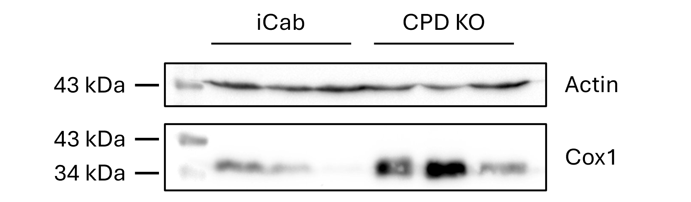

```{r setup, include=FALSE}
knitr::opts_chunk$set(echo = FALSE)
library(kableExtra)
```

# Introduction
- overall project -> CPD KO has aging problems -> mitochondrial origin?
- what is cox 1
- what is actin, vinculin (housekeeping)


# Results
```{r western-blot, out.width="60%", fig.align="center", fig.pos="H", fig.cap=wb_legend, fig.scap="Western blot of Cox1"}
wb_legend <- "\\textbf{The anti-Cox1 antibody is suitable for Western blot in medaka.}
Western blots of fin lysates from iCab and CPD KO medaka (n = 3 each), probed with
anti-actin (upper panel) and anti-Cox1 (lower panel) antibodies. Molecular weight
markers are indicated on the left. Actin, serving as loading control, shows bands of
similar intensity in all samples. The anti-Cox1 antibody detects a band at
approximately 37 kDa in all samples. Variation in Cox1 band intensity, including
saturated CPD KO bands, is likely due to sample overloading, as a lower input
(10 µl) resulted in stronger bands (data not shown). Band intensities therefore do
not reflect Cox1 protein levels. Sample input: 40 µl."


```

- company confirms lower band in mouse wb 
- protein size in medaka around 57?? i think


# Discussion 

# Materials and Methods

## Materials

### Buffers and Solutions
```{r buffers-table}
buffers <- data.frame(
  Name = c("Laemmli 2x, pH 6.8", "Tris Glycin 10x", "Running buffer", "Transfer buffer", "TBS 10x, pH 7.6", "TBST, pH 7.4 (Wash buffer)", "Blocking solution", "Stacking gel", "Resolving gel (10%)", "Cell culture medium"),
  Composition = c("126 mM Tris-HCl, 20% (v/v) Glycerol, 4% (w/v) SDS, 0.005% (w/v) Bromophenol Blue, 10% (v/v) β-Mercaptoethanol", "250 mM Tris base, 1900 mM Glycine", "1x Tris Glycine, 0.1% (w/v) SDS", "1x Tris Glycine, 20% (v/v) Methanol", "200 mM Tris-HCl, 1.37 M NaCl", "1x TBS, 0.1% (v/v) Tween 20", "1x TBST, 5% (w/v) non-fat dry milk", "5% (w/v) Acrylamide (30% stock), 125 mM Tris-HCl pH 6.8 (1.0 M stock), 0.1% (w/v) SDS (10% stock), 0.1% (w/v) APS (10% stock), 0.1% (v/v) TEMED, in H₂O", "10% (w/v) Acrylamide (30% stock), 375 mM Tris-HCl pH 8.8 (1.5 M stock), 0.1% (w/v) SDS (10% stock), 0.1% (w/v) APS (10% stock), 0.04% (v/v) TEMED, in H₂O", "DMEM (1x), 10% (v/v) Serum (FBS), 1% (v/v) Pen/Strep")
)

kable(buffers, booktabs = TRUE) %>%
  kable_styling(full_width = TRUE) %>%
  column_spec(1, width = "4.8cm") %>%
  column_spec(2, width = "10.8cm")
```

### Kits and devices
```{r tools-table}
tools <- data.frame(
  Name = c("Mini-PROTEAN® Tetra Vertical Electrophoresis Cell, 2-gel, for 1.5 mm thick handcast gels", "Mini-PROTEAN® Vertical Electrophoresis Cell, 4-gel, for Mini Precast Gels with Mini Trans-Blot® Module", "Clarity Western ECL Substrate, 500 ml", "ChemiDoc MP Imaging System With Image Lab Touch Software", "Immobilon®-P PVDF Membrane", "Color Prestained Protein Standard, Broad Range (10-250 kDa)", "Gibco™ DMEM (1x), high glucose, pyruvate", "Penicillin-Streptomycin (10.000 U/ml)", "Gibco™ Fetal Bovine Serum, Value", "Gibco™ DPBS, no calcium, no magnesium", "Gibco™ Trypsin-EDTA (0.05%), phenol red"),
  Model = c("#1658007FC", "#1658030", "#1705061", "12018025", "IPVH00010", "P7719SVIAL", "41966029", "15140122", "A5256701", "14190094", "25300054"),
  Company = c("Bio-Rad Laboratories, Inc.", "Bio-Rad Laboratories, Inc.", "Bio-Rad Laboratories, Inc.", "Bio-Rad Laboratories, Inc.", "Merck KGaA", "New England Biolabs", "Thermo Fisher Scientific Inc.", "Thermo Fisher Scientific Inc.", "Thermo Fisher Scientific Inc.", "Thermo Fisher Scientific Inc.", "Thermo Fisher Scientific Inc."),
  check.names = FALSE
)

kable(tools, booktabs = TRUE) %>%
  kable_styling(full_width = TRUE) %>%
  column_spec(1, width = "7.3cm") %>%
  column_spec(2, width = "3.33cm") %>%
  column_spec(3, width = "4.58cm")
```


### Antibodies 
```{r antibodies-table}                 
P_antibodies <- data.frame(
  Antigen = c("α-COX1", "α-actin", "α-vinculin", "α-mouse (HRP-conjugate)"),
  Host = c("Mouse", "Mouse", "Mouse", "Goat"),
  Company = c("Abcam Limited", "", "", ""),
  'Product Number' = c("", "", "", ""),
  Dilution = c("1:1000", "1:5000", "1:1000", "1:7500"),
  check.names = FALSE
)

kable(P_antibodies, booktabs = TRUE) %>%
  kable_styling(full_width = TRUE) %>%
  column_spec(1, width = "3.28cm") %>%
  column_spec(2:4, width = "2.88cm") %>%
  column_spec(5, width = "2.48cm")

```

### Biological material
**Medaka lines **
```{r medaka-table}
medaka <- data.frame(
  Genotype = c("iCab", "CPD KO"),
  Description = c("wildtype", "CPD knock out")
)

kable(medaka, booktabs = TRUE) %>%
  kable_styling(full_width = TRUE) %>%
  column_spec(1, width = "4.8cm") %>%
  column_spec(2, width = "10.8cm")
```
**Cell lines**
```{r cells-table}
cells <- data.frame(
  Genotype = c("3T3"),
  Origin = c("Mouse"),
  Description = c("wild type"),
  Passage = c("45")
)

kable(cells, booktabs = TRUE) %>%
  kable_styling(full_width = TRUE) %>%
  column_spec(1:4, width = "3.7cm")
```


## Methods 

### SDS-PAGE and Western Blot 
**SDS-PAGE**\
In order to prepare samples for SDS-PAGE and subsequent Western blot, Laemmli buffer (2x) was added to the frozen or fresh tissue and the tissue was homogenized by crushing with a pestle. Then, the samples were boiled at 95 °C for 5 minutes. Thereafter, the samples can be stored at −20 °C until use. For the SDS-PAGE gel, 8 ml stacking and 20 ml resolving gel were prepared (= 2 gels) and poured into the prepared gel cassette with resolving gel on the bottom and stacking gel on the top. To obtain a clean edge, the resolving gel was covered with water while polymerizing, then the water was removed, the stacking gel was added and a 10-well comb was inserted. To run the gel, the chamber was filled with running buffer, and subsequently the comb was removed and the wells were quickly rinsed to remove any residues. Thereafter, the samples and marker (Color Prestained Protein Standard) were loaded. During the stacking gel phase, the gel was run at 80 V, and after the samples entered the resolving gel, the voltage was increased to 100 V until completion.\
**Western blot**\
For the subsequent Western blot to transfer the proteins to a membrane (PVDF), an electro-blotting cassette was assembled. For this, the membrane was first activated by briefly placing it in 100% methanol, rinsing it with H₂O and subsequently placing it in transfer buffer to equilibrate. The sponges and Whatman paper were also placed in transfer buffer. The electro-blotting cassette was assembled in the following way: sponge, two sheets of Whatman paper, SDS-PAGE gel, membrane, two sheets of Whatman paper, sponge. The membrane was placed on the anode side of the gel to ensure transfer of the proteins towards the membrane. The transfer was performed at 100 V for 1 hour, with the chamber being placed on ice for cooling. Afterwards, the membrane was placed for 1 hour in blocking solution to prevent non-specific background binding. For subsequent antibody incubation overnight at 4 °C, the membrane was placed in a foil, 5 ml blocking solution containing primary antibody was added, and the foil was sealed with as little air as possible. Thereafter, the membrane was washed thrice for 7 minutes with TBST before being incubated with secondary antibody in blocking solution for 1 hour at room temperature. Then, the membrane was again washed twice for 10 minutes with TBST and once for 10 minutes with TBS at room temperature. All previous incubations and washes were performed in oscillation. For development of the chemiluminescence detection, the substrate working solution (ECL) was prepared by mixing equal parts of detection reagents 1 and 2, immediately added onto the membrane and incubated for 1 minute at room temperature in light. Afterwards, the membrane was placed in a foil and the excess liquid as well as air bubbles were carefully removed. For imaging, the membrane was placed in a ChemiDoc MP Imaging System.

### Image analysis
The western blots were analysed using Image Lab and Fiji. 

### Fish handeling

### Cell culture
Frozen 3T3 cells were thawed and transferred into a 15 ml Falcon tube for subsequent centrifugation at 1075 rpm for 4 minutes. Afterwards, the freezing medium was carefully removed without disrupting the pellet, and the cells were resuspended in 5 ml cell culture medium. Then, the cell suspension was transferred into a T75 flask, an additional 5 ml cell culture medium was added and the flask was placed in an incubator at 37 °C. After a few hours, once the cells had attached to the bottom of the flask, the medium was replaced with fresh medium to remove any DMSO residues and dead cells. \
Cells were split as soon as they reached 90% confluency. For this, the old medium was removed and the cells were washed twice with DPBS before adding 1 ml trypsin-EDTA for detachment. Once the cells had detached, they were resuspended in 10 ml cell culture medium, and 5 ml each were transferred into two T150 flasks containing 25 ml of additional cell culture medium, yielding a total volume of 30 ml per flask for further expansion.
